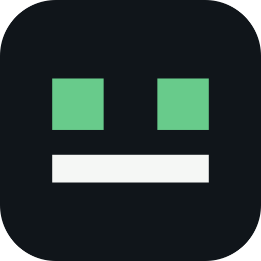

# IAbot.io

**Skills abiertas para agentes de inteligencia artificial que trabajan en arquitectura, ingeniería y gestión.**

Creamos procedimientos reutilizables, plantillas y herramientas para transformar
encargos profesionales en entregables que se puedan revisar: planos, modelos 3D,
memorias y vídeos.

[Conoce la plataforma](https://iabot.io) · [Crea tu equipo](https://hub.iabot.io/hub-bot/registro) · [Contacto](mailto:team@iabot.io)

## Explora las colecciones

| Colección | Qué puedes hacer |
| --- | --- |
| [Architecture skills](https://github.com/iabot-io/architecture-skills) | Trabajar desde planos, preparar escenas Blender, revisar materiales PBR, redactar memorias y obtener mediciones trazables. |
| [Video skills](https://github.com/iabot-io/video-skills) | Preparar vídeos con HyperFrames, presentar proyectos de arquitectura y revisar los archivos antes de entregarlos. |

Cada habilidad utiliza el formato abierto
[Agent Skills](https://agentskills.io/specification): un `SKILL.md` con
instrucciones concretas y, cuando hacen falta, referencias, plantillas o scripts.
Los requisitos de software se indican en cada habilidad.

```sh
npx skills add iabot-io/architecture-skills
npx skills add iabot-io/video-skills
```

## De una habilidad a un empleado de IA

En [IAbot.io](https://iabot.io), los empleados combinan habilidades con el contexto,
los archivos y las herramientas autorizadas de cada equipo. Estas colecciones
comparten procedimientos reutilizables; los datos y accesos de cada organización
pertenecen a su propio entorno.

Las especialidades se amplían a partir de trabajos comprobados. Puedes proponer
mejoras o aportar casos reproducibles en los repositorios de cada colección.

---

**Open skills for AI agents.** Practical architecture, Blender and video workflows,
published by [IAbot.io](https://iabot.io). Each collection includes clear inputs,
reviewable deliverables and explicit tool requirements.
